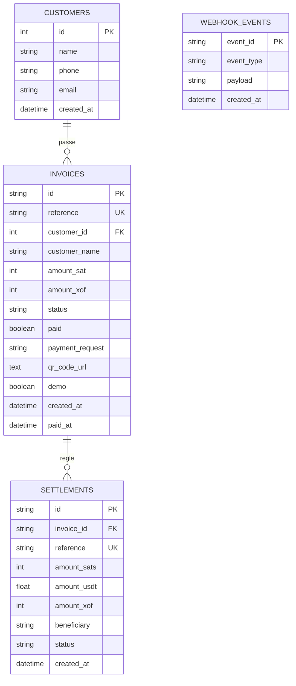

# Schema de la Base de Donnees (db-schema.md)

Ce document decrit le modele relationnel SQLAlchemy et les vues SQL analytiques de l'ERP de Paiements.

---

## 1. Tables Relationnelles



---

## 2. Dictionnaire des Tables

### Table `customers`
| Colonne | Type | Contraintes | Description |
|---|---|---|---|
| `id` | INTEGER | PRIMARY KEY, AUTOINCREMENT | Identifiant interne |
| `name` | VARCHAR(120) | NOT NULL | Nom du client ou entreprise |
| `phone` | VARCHAR(50) | NULLABLE | Numero de telephone (Mobile Money) |
| `email` | VARCHAR(120) | NULLABLE | Email de contact |
| `created_at` | DATETIME | DEFAULT CURRENT_TIMESTAMP | Date de creation |

### Table `invoices`
| Colonne | Type | Contraintes | Description |
|---|---|---|---|
| `id` | VARCHAR(100) | PRIMARY KEY | Identifiant unique (Bitnob ID ou generé) |
| `reference` | VARCHAR(100) | UNIQUE, NOT NULL | Reference unique de facturation |
| `customer_id` | INTEGER | FOREIGN KEY -> customers.id, NULLABLE | Lien optionnel avec un client |
| `customer_name` | VARCHAR(120) | DEFAULT "Client Comptoir" | Nom affiche sur la facture |
| `amount_sat` | INTEGER | NOT NULL | Montant en satoshis |
| `amount_xof` | INTEGER | DEFAULT 0 | Contrevaleur estimee en Franc CFA |
| `description` | TEXT | NOT NULL | Motif d'encaissement |
| `status` | VARCHAR(30) | DEFAULT "pending" | Statut : `pending`, `paid`, `expired` |
| `paid` | BOOLEAN | DEFAULT FALSE | Indicateur rapide de reglement |
| `payment_request` | TEXT | NULLABLE | Chaine BOLT11 Lightning (lntb...) |
| `qr_code_url` | TEXT | NULLABLE | Image PNG data URI pour affichage direct |
| `demo` | BOOLEAN | DEFAULT FALSE | Indique si le reglement est issu d'une simulation |
| `created_at` | DATETIME | DEFAULT CURRENT_TIMESTAMP | Horodatage de creation |
| `paid_at` | DATETIME | NULLABLE | Horodatage du reglement effectif |

### Table `settlements`
| Colonne | Type | Contraintes | Description |
|---|---|---|---|
| `id` | VARCHAR(100) | PRIMARY KEY | Identifiant unique de reglement |
| `invoice_id` | VARCHAR(100) | FOREIGN KEY -> invoices.id, NULLABLE | Facture source liee |
| `reference` | VARCHAR(100) | UNIQUE, NOT NULL | Reference payout |
| `amount_sats` | INTEGER | NOT NULL | Satoshis convertis |
| `amount_usdt` | FLOAT | DEFAULT 0.0 | Montant converti en USDT |
| `amount_xof` | INTEGER | NOT NULL | Montant verse en XOF |
| `beneficiary` | VARCHAR(60) | NOT NULL | Destinataire Mobile Money (+221...) |
| `status` | VARCHAR(30) | DEFAULT "INITIATED" | Statut : INITIATED, COMPLETED, FAILED |
| `created_at` | DATETIME | DEFAULT CURRENT_TIMESTAMP | Horodatage de l'operation |

### Table `webhook_events`
| Colonne | Type | Contraintes | Description |
|---|---|---|---|
| `id` | INTEGER | PRIMARY KEY, AUTOINCREMENT | Identifiant sequentiel |
| `event_id` | VARCHAR(120) | UNIQUE, NOT NULL | ID Bitnob anti-replay |
| `event_type` | VARCHAR(60) | NOT NULL | Type : transfer.success, deposit.success |
| `raw_payload` | TEXT | NOT NULL | Copie brute du corps JSON recu |
| `created_at` | DATETIME | DEFAULT CURRENT_TIMESTAMP | Horodatage de reception |

---

## 3. Vues SQL Analytiques (`db/views.sql`)

### Vue `v_kpis`
Synthese financiere des indicateurs cles :
```sql
CREATE VIEW IF NOT EXISTS v_kpis AS
SELECT
    COALESCE(SUM(CASE WHEN paid = 1 THEN amount_xof ELSE 0 END), 0) AS total_revenue_xof,
    COALESCE(SUM(CASE WHEN paid = 1 THEN amount_sat ELSE 0 END), 0) AS total_sats_collected,
    COUNT(id) AS total_invoices_count,
    COALESCE(SUM(CASE WHEN paid = 1 THEN 1 ELSE 0 END), 0) AS paid_invoices_count,
    COALESCE(SUM(CASE WHEN paid = 0 THEN 1 ELSE 0 END), 0) AS pending_invoices_count,
    (SELECT COALESCE(SUM(amount_xof), 0) FROM settlements WHERE status = 'COMPLETED') AS settled_xof_total
FROM invoices;
```

### Vue `v_transactions_summary`
Vue unifiee employee par l'agent IA (P3) pour repondre aux questions metier complexes :
```sql
CREATE VIEW IF NOT EXISTS v_transactions_summary AS
SELECT 
    i.id AS invoice_id,
    i.reference,
    i.customer_name,
    i.amount_sat,
    i.amount_xof,
    i.description,
    i.status,
    i.paid,
    i.demo,
    i.created_at,
    i.paid_at,
    s.id AS settlement_id,
    s.amount_usdt AS settled_usdt,
    s.beneficiary AS payout_beneficiary,
    s.status AS settlement_status
FROM invoices i
LEFT JOIN settlements s ON s.invoice_id = i.id;
```
